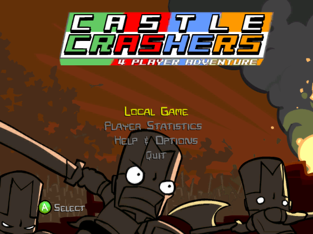
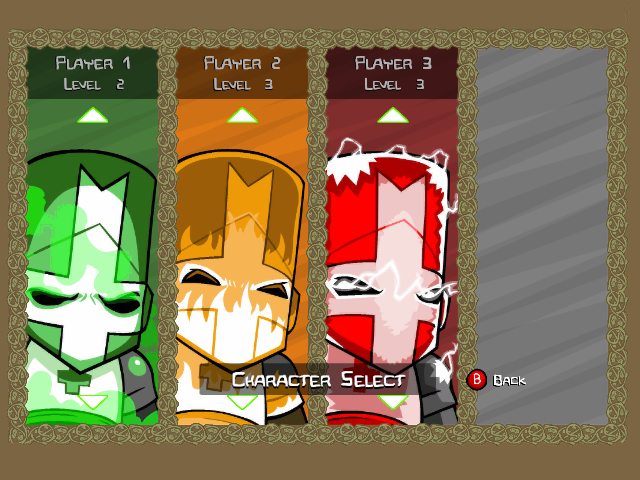

# Castle Crashers X

Castle Crashers (Xbox 360 Live Arcade) running natively on the original Xbox.
Target: a stock 64 MB retail console at 30 FPS.

  
  

*Screenshots captured on a real original Xbox.*

## Status

- All 58 levels play, with four players.
- Fights mostly hold 30 FPS; level loads and area changes still dip briefly.
- Saving, music, sound effects and the in-game reset (LT + RT + Back + Black) work.
- Xbox Live features (leaderboards, achievements, online play, DLC) are removed.
- All You Can Quaff is removed.

## Installing

You need your own copy of the Xbox 360 game. Run
`installer/publish/CastleCrashersXInstaller.exe`, point it at the 360 package,
and it builds a game folder to copy to the Xbox.

## How it works

The 360 executable is statically recompiled; native code then replaces the
translated parts piece by piece (Flash VM, renderer, audio, file I/O), checked
against the recompiled original. Gameplay itself is ActionScript inside the
game's SWF files.

| Folder | Contents |
| --- | --- |
| `nxdk-checkpoint022` | Xbox build (nxdk): renderer, input, audio, kernel shims |
| `runtime021` | Recompiled game code and its native replacements |
| `runtime006`–`011`, `xbox-runtime` | Shared runtime code used by the build |
| `installer` | Windows installer that converts the 360 package |
| `tools` | Console and data tools |

No game content is stored in this repository.
