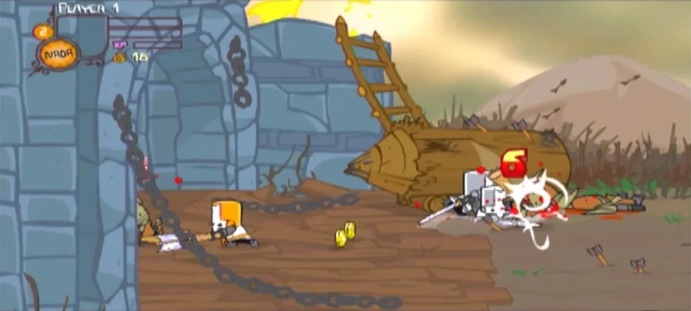

# Castle Crashers X

**Castle Crashers** by **The Behemoth** (Xbox 360 Live Arcade edition published
by **Microsoft Game Studios**), running natively on the original Xbox.

  
  
  

*Captured on a real original Xbox.*

This is an unofficial fan port, not affiliated with or endorsed by The Behemoth
or Microsoft. It contains no game content: the installer builds everything from
your own copy of the Xbox 360 game.

## Features

- The full Castle Crashers adventure: all 58 levels, the map, shops and the Arena.
- Up to four players on one console.
- Runs on a stock 64 MB retail Xbox; fights run at or near 30 FPS.
- Saves to the Xbox hard drive, with the game's icon in the dashboard.
- Music and sound effects.
- In-game reset: hold **LT + RT + Back + Black** to return to the dashboard.
- Xbox Live features (leaderboards, achievements, online play, DLC store) are removed.
- All You Can Quaff is removed.

## Installing

You need:

- Your own Xbox LIVE (Xbox 360) package of Castle Crashers.
- A Windows PC.
- An original Xbox that can run homebrew, with about 300 MB free.

Steps:

1. Download the release zip and extract it.
2. Run `CastleCrashersXInstaller.exe`.
3. Choose the Xbox LIVE package and an output folder, then press **Start**.
4. Copy the finished folder to your Xbox (for example to `E:\Games\`).
5. Launch `default.xbe` from your dashboard.

## How it works

The Xbox 360 executable is statically recompiled with ReXGlue. Native code then
replaces the translated parts piece by piece (Flash VM, renderer, audio, file
access), checked against the recompiled original. The Xbox build uses the nxdk
toolkit. Gameplay itself is ActionScript inside the game's own SWF files.

| Folder | Contents |
| --- | --- |
| `nxdk-checkpoint022` | Xbox build (nxdk): renderer, input, audio, kernel shims |
| `runtime021` | Recompiled game code and its native replacements |
| `runtime006`–`011`, `xbox-runtime` | Shared runtime code used by the build |
| `installer` | Windows installer that converts the 360 package |
| `tools` | Console and data tools |
| `docs` | Developer notes, third-party notices, screenshots |

Developer notes: [docs/DEVELOPMENT.md](docs/DEVELOPMENT.md).

## Credits

- **The Behemoth**: developer of Castle Crashers.
- **Microsoft Game Studios**: publisher of the Xbox 360 Live Arcade edition.
- **ReXGlue**: the Xbox 360 static recompiler this port is built on.
- **nxdk**: the open-source original Xbox development kit used for the Xbox build.
- **FFmpeg**: audio conversion in the installer.

Castle Crashers is a trademark of The Behemoth. Xbox is a trademark of Microsoft.
See [docs/THIRD_PARTY.md](docs/THIRD_PARTY.md) for licences.
